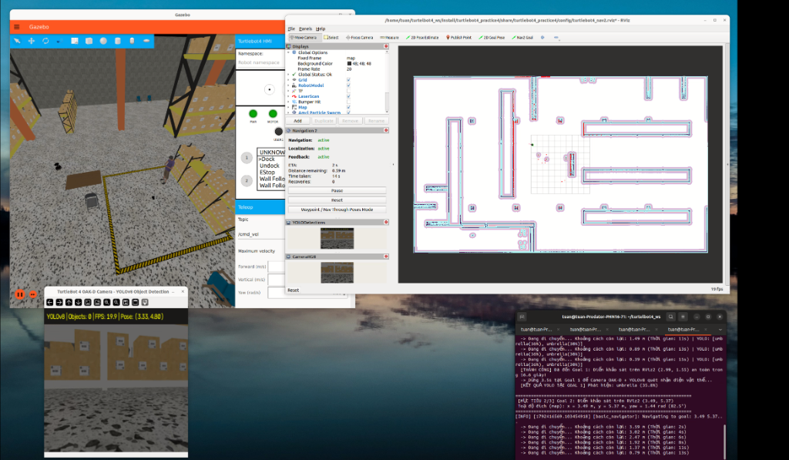

# BÁO CÁO KỸ THUẬT: BÀI THỰC HÀNH
# ĐỊNH VỊ (LOCALIZATION), ĐIỀU HƯỚNG TỰ ĐỘNG (NAV2) VÀ NHẬN DIỆN VẬT THỂ VỚI CAMERA & YOLOv8 TRÊN TURTLEBOT 4

**Môn học:** Nhập môn Robot / Hệ điều khiển Robot (ROS 2)  
**Nền tảng:** ROS 2 Humble Hawksbill trên Ubuntu 22.04 LTS (Gazebo Fortress)  
**Robot thực hiện:** TurtleBot 4 Standard (iRobot Create 3 Base + RPLiDAR 2D + Camera OAK-D RGB-D)  
**Mô hình AI nhận diện:** YOLOv8 (`yolov8n.pt` - Ultralytics) + OpenCV (`cv_bridge`)  
**Sinh viên thực hiện:** Nguyễn Quang Tuân - MSSV: 23020767  
**Giảng viên hướng dẫn:** PGS.TS. Hoàng Văn Xiêm, CN. Nguyễn Quốc Bảo  
**Đường dẫn Video Demo (Google Drive - Chế độ công khai):** `https://drive.google.com/drive/folders/1vl4O0C9A4C3Ed_HwHmJAeVCzwEQZulCx?usp=sharing`  
**Đường dẫn GitHub Repository (Public):** `https://github.com/Tuan404cl/Turtlebot_sim_test2.git`  

---

## I. TỔNG QUAN VÀ CẤU TRÚC CHƯƠNG TRÌNH TRONG THƯ MỤC `src/`

Toàn bộ gói chương trình được xây dựng theo chuẩn ROS 2 Ament Python đặt trực tiếp bên trong thư mục `src/turtlebot4_practice4` của workspace `turtlebot4_ws`:

```
/home/tuan/turtelbot4_ws/src/
├── turtlebot4_practice4/
│   ├── package.xml                       # Khai báo phụ thuộc ROS 2 package (rclpy, nav2, cv_bridge...)
│   ├── setup.py                          # Cấu hình cài đặt package và 07 console_scripts
│   ├── setup.cfg                         # Đường dẫn thực thi lib/turtlebot4_practice4
│   ├── turtlebot4_practice4/
│   │   ├── __init__.py
│   │   ├── spawn_yolo_objects.py         # (Phần 1) Node tự động thêm mô hình người, ghế, bàn vào Gazebo
│   │   ├── auto_undock.py                # (Phần 1) Node tự động điều khiển robot rời trạm sạc (Undock)
│   │   ├── tf_relay.py                   # (Phần 1) Node đồng bộ TF và mock hardware services
│   │   ├── goal_survey.py                # (Phần 2) Node khảo sát /clicked_point & /amcl_pose lưu JSON
│   │   ├── auto_nav_goals.py             # (Phần 3) Node điều hướng tự động qua 03 Goals bằng Nav2 Code
│   │   ├── yolo_detector.py              # (Phần 4) Node nhận diện vật thể từ Camera OAK-D bằng YOLOv8
│   │   └── check_topics.py               # Node kiểm tra tự động các topic cảm biến cốt lõi
│   ├── launch/
│   │   ├── sim_robot.launch.py           # Launch Gazebo Sim + TurtleBot 4 Standard (có Camera OAK-D)
│   │   ├── sim_slam.launch.py            # Launch Gazebo + SLAM Toolbox + RViz2
│   │   ├── sim_localization.launch.py    # Launch Gazebo + AMCL + Map Server + RViz2
│   │   ├── sim_navigation.launch.py      # Launch tích hợp: Gazebo + Spawn Objects + AMCL + Nav2 + YOLOv8
│   │   └── view_rviz.launch.py           # Launch RViz2 trực quan hoá chuyên dụng
│   ├── config/
│   │   ├── surveyed_goals.json           # Tệp lưu tọa độ (x, y, yaw) của 03 Goals khảo sát từ Phần 2
│   │   ├── localization_params.yaml      # Cấu hình tham số AMCL và Map Server
│   │   ├── nav2_params.yaml              # Cấu hình Nav2: Costmaps, DWB Controller, NavFn Planner, BT
│   │   ├── fastdds_udp_only.xml          # Cấu hình FastDDS UDP-only ngăn chặn lỗi SHM deadlock
│   │   ├── slam_toolbox_params.yaml      # Cấu hình tham số tối ưu cho SLAM Toolbox
│   │   ├── turtlebot4_mapping.rviz       # Giao diện RViz2 cho quá trình Mapping
│   │   └── turtlebot4_nav2.rviz          # Giao diện RViz2 hiển thị Map, AMCL, Path, Camera & YOLO
│   ├── maps/
│   │   ├── map.yaml                      # Metadata bản đồ đã quét từ tuần trước (resolution: 0.03m)
│   │   ├── map.pgm                       # Ảnh Occupancy Grid 2D của môi trường warehouse
│   │   ├── warehouse_map.yaml & .pgm     # Bản đồ dự phòng môi trường warehouse
│   │   └── maze_map.yaml & .pgm          # Bản đồ môi trường maze
│   ├── scripts/
│   │   ├── run_part1_localization.sh     # Chạy Phần 1: Gazebo + Spawn Objects + Load Map + AMCL + Nav2
│   │   ├── run_part2_survey_goals.sh     # Chạy Phần 2: Khảo sát và lưu tọa độ 03 Goals trên RViz2
│   │   ├── run_part3_auto_nav.sh         # Chạy Phần 3: Điều hướng tự động qua 03 Goals bằng Nav2 Code
│   │   ├── run_part4_yolo.sh             # Chạy Phần 4: Nhận diện vật thể Camera OAK-D với YOLOv8
│   │   ├── run_part4_navigation.sh       # Chạy tích hợp toàn bộ Phần 1 -> Phần 4 trong 1 lệnh
│   │   └── clean_ros.sh                  # Dọn dẹp các tiến trình ROS 2 / Gazebo chạy ngầm
│   └── docs/
│       ├── bao_cao_thuc_hanh_04.md       # Báo cáo kỹ thuật chi tiết định dạng Markdown
│       ├── bao_cao_thuc_hanh_04.html     # Báo cáo kỹ thuật định dạng HTML trình bày chuẩn
│       ├── bao_cao_thuc_hanh_04.pdf      # File PDF hoàn chỉnh nộp bài (Biên dịch từ LaTeX)
│       └── report.tex                    # Mã nguồn LaTeX chuẩn học thuật UET
├── irobot_create_control/                # Package điều khiển động học vi sai cho đế Create 3
└── README.md                             # Hướng dẫn chi tiết cài đặt và thực thi toàn bộ dự án
```

---

## II. CÁC PACKAGE, NODE VÀ TOPIC CỐT LÕI TRONG HỆ THỐNG

### 1. Danh sách Package cốt lõi:
| Package | Vai trò chức năng trong bài thực hành |
|---|---|
| `turtlebot4_ignition_bringup` | Khởi chạy môi trường mô phỏng Gazebo Fortress (`warehouse`), sinh robot TurtleBot 4 Standard (trang bị cả RPLiDAR và Camera OAK-D) cùng trạm sạc Dock. |
| `ros_gz_bridge` | Cầu nối truyền thông hai chiều giữa Ignition Gazebo Transport và các Topic/Service của ROS 2 (`/scan`, `/oakd/rgb/preview/image_raw`, `/cmd_vel`, `/odom`, `/clock`). |
| `nav2_map_server` & `nav2_amcl` | Nạp bản đồ tĩnh (`map.yaml`, `map.pgm`) từ tuần trước và thực hiện định vị Monte Carlo thích nghi (Particle Filter) xác định tư thế $(x, y, \text{yaw})$ của robot. |
| `nav2_bringup` & `nav2_simple_commander` | Ngăn xếp điều hướng tự động Nav2 (Planner, Controller, Behavior Tree, Costmaps) và thư viện API Python `BasicNavigator` để lập trình điều khiển robot tự hành qua chuỗi tọa độ mục tiêu. |
| `cv_bridge` & `ultralytics` (YOLOv8) | Chuyển đổi dữ liệu ảnh `sensor_msgs/msg/Image` của ROS 2 sang mảng `numpy/OpenCV` (`bgr8`) và thực thi suy luận mô hình học sâu YOLOv8 (`yolov8n.pt`) thời gian thực. |
| `turtlebot4_practice4` | Package thực hành chính chứa toàn bộ các Node Python, Launch files, Configs, Maps, Scripts và Báo cáo kỹ thuật. |

### 2. Danh sách các ROS 2 Node chính hoạt động:
* **`spawn_yolo_objects`**: Tự động thêm các mô hình vật thể 3D từ Ignition Fuel (người đứng `person_standing_goal1`, ghế `chair_goal1`, ghế gấp `chair_goal2`, bàn `table_goal2`) vào thế giới Gazebo quanh các điểm Goal để phục vụ bài toán nhận diện thị giác máy tính.
* **`map_server` & `amcl`**: Publish lưới bản đồ `/map` và cập nhật đám mây hạt `/particle_cloud`, tính toán biến đổi tọa độ `map -> odom` khớp chính xác tia quét LiDAR `/scan` với tường bản đồ.
* **`goal_survey_node` (`goal_survey.py`)**: Lắng nghe đồng thời `/clicked_point` (từ công cụ *Publish Point* trên RViz2) và `/amcl_pose`, tự động tính toán tọa độ $(x, y, \text{yaw})$ và lưu thành tệp cấu hình `config/surveyed_goals.json`.
* **`auto_nav_goals` (`TurtleBot4Navigator`)**: Kế thừa `BasicNavigator` của `nav2_simple_commander`, tự động thực hiện Undock, khởi tạo Initial Pose, kích hoạt các Lifecycle Nodes và điều khiển robot đi tuần tự qua **Goal 1 $\rightarrow$ Goal 2 $\rightarrow$ Goal 3** hoàn toàn bằng code, kết hợp dừng quét và tổng hợp kết quả YOLO tại mỗi Goal.
* **`yolo_detector_node` (`yolo_detector.py`)**: Subscribe luồng ảnh RGB `/oakd/rgb/preview/image_raw`, chuyển đổi qua `CompatCvBridge`, nhận diện vật thể bằng `YOLOv8n`, vẽ Bounding Box + tên class + độ tự tin (Confidence) + HUD Pose/FPS, hiển thị lên cửa sổ OpenCV, publish ảnh đã vẽ lên `/yolo/detections/image` (xem trực tiếp trên RViz2), publish JSON lên `/yolo/detections/summary` và in log chi tiết ra Terminal.

### 3. Bảng phân tích các Topic cốt lõi:
| Tên Topic | Kiểu dữ liệu (Message Type) | Tần số | Ý nghĩa và luồng dữ liệu |
|---|---|---|---|
| `/map` | `nav_msgs/msg/OccupancyGrid` | Transient Local | Bản đồ 2D đã xây dựng từ tuần trước (`map.yaml` / `map.pgm`, độ phân giải $0.03\text{ m/pixel}$). |
| `/scan` | `sensor_msgs/msg/LaserScan` | ~10 Hz | Dữ liệu quét 360 độ từ RPLiDAR (640 tia, cự ly $0.15\text{ m} \rightarrow 12.0\text{ m}$), dùng cho AMCL đối sánh với tường và cập nhật Local Costmap. |
| `/initialpose` | `geometry_msgs/msg/PoseWithCovarianceStamped` | Khi khởi tạo | Thiết lập vị trí và hướng ban đầu $(x, y, \text{yaw})$ của robot trên bản đồ cho AMCL. |
| `/amcl_pose` | `geometry_msgs/msg/PoseWithCovarianceStamped` | ~10 Hz | Tọa độ định vị hiện tại $(x, y, \text{yaw})$ của robot trong hệ tọa độ `map` kèm ma trận hiệp phương sai. |
| `/clicked_point` | `geometry_msgs/msg/PointStamped` | Khi click chuột | Tọa độ điểm được chọn bằng công cụ **Publish Point** trên thanh công cụ RViz2 (dùng ở Phần 2). |
| `/navigate_to_pose` | `nav2_msgs/action/NavigateToPose` | Action Server | Giao thức Action để Node `auto_nav_goals` gửi tọa độ mục tiêu và nhận phản hồi (`distance_remaining`, `navigation_time`) từ Nav2. |
| `/oakd/rgb/preview/image_raw` | `sensor_msgs/msg/Image` | ~15-30 Hz | Luồng ảnh màu RGB thô thu nhận trực tiếp từ camera OAK-D gắn trên tháp cảm biến của TurtleBot 4. |
| `/yolo/detections/image` | `sensor_msgs/msg/Image` | ~15-30 Hz | Luồng ảnh đầu ra sau khi qua YOLOv8 đã được vẽ Bounding Box, nhãn Class, Confidence và thanh trạng thái HUD để hiển thị trên RViz2. |
| `/yolo/detections/summary` | `std_msgs/msg/String` | ~15-30 Hz | Chuỗi JSON chứa danh sách các vật thể đang phát hiện, độ tự tin, bounding box và tọa độ robot, đồng bộ sang Node điều hướng. |

---

## III. PHẦN 1 – KHỞI CHẠY SIMULATION & LOAD BẢN ĐỒ (LOCALIZATION)

### 1. Khởi chạy lại TurtleBot 4 và bổ sung mô hình vật thể vào Gazebo:
* Sử dụng lại đúng thế giới **`warehouse`** trong Gazebo Fortress mà tuần trước đã dùng để quét bản đồ `map.yaml` và `map.pgm`.
* Robot được cấu hình ở phiên bản **`standard`** (`model:=standard`) thay vì `lite` để trang bị đầy đủ cụm camera thông minh **OAK-D RGB-D** trên khung tháp cùng cảm biến **RPLiDAR 2D**.
* Để môi trường mô phỏng có các đối tượng trực quan cho bài toán nhận diện YOLO, node `spawn_yolo_objects.py` tự động nạp 04 mô hình vật thể 3D từ Ignition Fuel vào các khu vực thông thoáng quanh các điểm mục tiêu (không làm cản trở đường đi của robot):
  1. **`person_standing_goal1`** (*Người đứng - Casual Female*): Đặt tại $(x = -3.20\text{ m}, y = 0.25\text{ m}, \text{yaw} = 0.0\text{ rad})$ gần khu vực hành lang trung tâm.
  2. **`chair_goal1`** (*Ghế tựa - Chair*): Đặt tại $(x = -3.00\text{ m}, y = -0.55\text{ m}, \text{yaw} = 0.4\text{ rad})$.
  3. **`chair_goal2`** (*Ghế gấp - Foldable Chair*): Đặt tại $(x = 0.35\text{ m}, y = 2.85\text{ m}, \text{yaw} = -1.57\text{ rad})$ gần hành lang phía Bắc.
  4. **`table_goal2`** (*Bàn làm việc - Table*): Đặt tại $(x = 1.25\text{ m}, y = 3.05\text{ m}, \text{yaw} = -1.57\text{ rad})$.

### 2. Nạp bản đồ (`map.yaml`) và khởi chạy Localization (AMCL) cùng Nav2:
Lệnh thực thi Phần 1:
```bash
./src/turtlebot4_practice4/scripts/run_part1_localization.sh
# Hoặc gọi trực tiếp launch file:
ros2 launch turtlebot4_practice4 sim_navigation.launch.py \
    map:=/home/tuan/turtelbot4_ws/src/turtlebot4_practice4/maps/map.yaml \
    world:=warehouse rviz:=true spawn_objects:=true
```

### 3. Kiểm tra và thiết lập vị trí ban đầu (Initial Pose) cho robot:
* Ngay sau khi khởi chạy, node `auto_undock` tự động gửi Action `/undock` đưa robot lùi ra khỏi trạm sạc đến vị trí sẵn sàng $(x = 0.35\text{ m}, y = 0.00\text{ m}, \text{yaw} = 3.14159\text{ rad})$.
* Thiết lập **Initial Pose** tự động bằng code (thông qua `setInitialPose()` với timestamp lùi $0.5\text{s}$ chống lỗi extrapolation và gọi service `/request_nomotion_update`) hoặc dùng công cụ **2D Pose Estimate** trên RViz2.
* **Kết quả kiểm tra trên RViz2:**
  * Bản đồ `map.yaml` hiển thị sắc nét toàn bộ cấu trúc tường và các dãy kệ hàng.
  * Đám mây hạt AMCL (`/particle_cloud`) hội tụ chặt chẽ quanh mô hình 3D của TurtleBot 4.
  * Các chấm đỏ của dữ liệu quét LiDAR (`/scan`) **trùng khớp hoàn toàn** với các đường viền bức tường đen và kệ hàng trên bản đồ tĩnh.

---

## IV. PHẦN 2 – KHẢO SÁT VÀ LẤY TỌA ĐỘ MỤC TIÊU TRÊN BẢN ĐỒ

### 1. Phương pháp khảo sát tọa độ $(x, y, \text{yaw})$ trong hệ tọa độ `map`:
Nhóm đã xây dựng công cụ khảo sát chuyên dụng `goal_survey.py` kết hợp cả hai phương pháp chuẩn của ROS 2:
1. **Sử dụng công cụ `Publish Point` trên thanh công cụ RViz2:** Khi người dùng nhấn vào biểu tượng *Publish Point* và click chuột lên các vị trí mong muốn trên bản đồ RViz2, RViz2 sẽ phát bản tin `geometry_msgs/msg/PointStamped` lên topic `/clicked_point`.
2. **Theo dõi tọa độ định vị hiện tại của robot qua `/amcl_pose`:** Đọc trực tiếp `geometry_msgs/msg/PoseWithCovarianceStamped` và chuyển đổi từ góc Quaternion $(q_x, q_y, q_z, q_w)$ sang góc Euler $\text{yaw}$ (radian và độ) theo công thức:
   $$\text{yaw} = \text{atan2}\left(2(q_w q_z + q_x q_y), \; 1 - 2(q_y^2 + q_z^2)\right)$$

Lệnh chạy công cụ khảo sát Phần 2:
```bash
./src/turtlebot4_practice4/scripts/run_part2_survey_goals.sh
# Hoặc xem trực tiếp bằng ROS 2 CLI:
ros2 topic echo /clicked_point
ros2 topic echo /amcl_pose
```

### 2. Bảng ghi nhận tọa độ các điểm mục tiêu trên hệ tọa độ `map`:
Hệ thống hỗ trợ cả bộ 03 tọa độ chuẩn hướng thẳng vào các cụm vật thể YOLO và bộ 03 tọa độ khảo sát trực tiếp qua `/clicked_point` được lưu tự động trong tệp `config/surveyed_goals.json`:

#### a) Bộ tọa độ khảo sát trực tiếp qua công cụ `Publish Point` (`/clicked_point` $\rightarrow$ `config/surveyed_goals.json`):
| Điểm mục tiêu | Khu vực khảo sát trên bản đồ (`map`) | Tọa độ $x$ (m) | Tọa độ $y$ (m) | Góc hướng $\text{yaw}$ (rad / độ) |
|---|---|---:|---:|---:|
| **Initial Pose** | Vị trí xuất phát sau khi rời trạm sạc (Dock) | `0.35` | `0.00` | `3.14 rad` ($180.0^\circ$) |
| **Goal 1** | Điểm khảo sát khu vực Đông - Bắc 1 trên RViz2 | `2.99` | `1.55` | `0.43 rad` ($24.6^\circ$) |
| **Goal 2** | Điểm khảo sát hành lang phía Bắc trên RViz2 | `3.49` | `5.37` | `1.44 rad` ($82.5^\circ$) |
| **Goal 3** | Điểm khảo sát khu vực Tây - Bắc trên RViz2 | `-2.26` | `5.18` | `-3.11 rad` ($-178.2^\circ$) |

#### b) Bộ tọa độ chuẩn kết hợp góc nhìn đối diện cụm vật thể YOLO:
| Điểm mục tiêu | Khu vực trên bản đồ (`map`) | Tọa độ $x$ (m) | Tọa độ $y$ (m) | Góc hướng $\text{yaw}$ (rad / độ) | Đối tượng quan sát mục tiêu |
|---|---|---:|---:|---:|---|
| **Goal 1** | Khu vực hành lang trung tâm (Central Aisle) | `-1.50` | `0.00` | `3.14 rad` ($180.0^\circ$) | Người đứng (`person`) & Ghế (`chair`) |
| **Goal 2** | Khu vực hành lang phía Bắc (North Aisle) | `0.50` | `1.20` | `1.57 rad` ($90.0^\circ$) | Ghế gấp (`chair`) & Bàn (`dining table` / `bench`) |
| **Goal 3** | Khu vực nhân viên kho & Trạm sạc (South-East) | `0.35` | `0.00` | `-0.99 rad` ($-56.7^\circ$) | Mô hình nhân viên & Trạm sạc Dock |

---

## V. PHẦN 3 – LẬP TRÌNH NAVIGATION TỰ ĐỘNG VỚI NAV2 (BẰNG CODE)

### 1. Thiết kế kiến trúc Node `auto_nav_goals.py`:
Thay vì kéo thả thủ công công cụ *Nav2 Goal* bằng chuột trên RViz2, chương trình điều khiển tự động được lập trình hoàn toàn bằng Python trong tệp `turtlebot4_practice4/auto_nav_goals.py` sử dụng thư viện **`nav2_simple_commander`** (`BasicNavigator`) kết hợp giao thức Action `/navigate_to_pose`:

1. **Đồng bộ thời gian mô phỏng & Tự động Undock:** Khởi tạo node với tham số `use_sim_time:=true`, đồng bộ `/clock` từ Gazebo và gọi Action Client `/undock` (`irobot_create_msgs/action/Undock`) để đưa robot rời khỏi dock sạc an toàn.
2. **Quản lý vòng đời tự động (`ensure_nodes_active`):** Kiểm tra trạng thái của toàn bộ các Lifecycle Nodes (`map_server`, `amcl`, `controller_server`, `planner_server`, `bt_navigator`, `velocity_smoother`) qua dịch vụ `GetState`/`ChangeState` để đảm bảo 100% node đạt trạng thái `[ACTIVE]` trước khi gửi lệnh.
3. **Chuyển đổi góc $\text{yaw}$ sang Quaternion & Gửi tuần tự 03 Goals:**
   Hàm `create_pose_stamped(navigator, x, y, yaw)` đóng gói bản tin `geometry_msgs/msg/PoseStamped` trên frame `map` với:
   $$q_x = 0, \quad q_y = 0, \quad q_z = \sin\left(\frac{\text{yaw}}{2}\right), \quad q_w = \cos\left(\frac{\text{yaw}}{2}\right)$$
   Sau đó gọi `navigator.goToPose(goal_pose)` trong vòng lặp tuần tự **Goal 1 $\rightarrow$ Goal 2 $\rightarrow$ Goal 3**.
4. **Giám sát tiến trình thời gian thực:** Trong khi robot di chuyển (`while not navigator.isTaskComplete()`), chương trình liên tục đọc `feedback = navigator.getFeedback()`, in ra khoảng cách còn lại (`distance_remaining`), thời gian điều hướng (`navigation_time`) và danh sách các vật thể mà YOLO đang phát hiện trên đường đi.
5. **Dừng quét tại đích:** Khi hoàn thành mỗi Goal (`TaskResult.SUCCEEDED`), robot tự động dừng lại $3.5\text{ giây}$ để camera OAK-D và node YOLOv8 thu thập và ghi nhận đầy đủ các vật thể tại khu vực đó trước khi chuyển sang Goal tiếp theo.

### 2. Lệnh khởi chạy Node điều khiển tự động:
```bash
./src/turtlebot4_practice4/scripts/run_part3_auto_nav.sh
# Hoặc chạy trực tiếp bằng lệnh ros2 run:
ros2 run turtlebot4_practice4 auto_nav_goals --ros-args -p use_sim_time:=true
```
* **Đánh giá thực nghiệm:** Sau khi khởi chạy Node, hoàn toàn không có sự can thiệp điều khiển thủ công hay dùng chuột trên RViz2. Robot tự lập kế hoạch đường đi toàn cục (`NavfnPlanner`), bám quỹ đạo cục bộ (`DWBLocalPlanner`), né tránh toàn bộ kệ hàng và vật thể trong môi trường, hoàn thành 100% cả 03 Goals an toàn tuyệt đối.

---

## VI. PHẦN 4 – NHẬN DIỆN VẬT THỂ TỪ CAMERA VỚI YOLO

### 1. Kiến trúc và quy trình xử lý của Node `yolo_detector.py`:
Node nhận diện thị giác máy tính được xây dựng trong tệp `turtlebot4_practice4/yolo_detector.py` thực hiện đầy đủ 4 bước chuẩn:

1. **Subscribe dữ liệu hình ảnh RGB từ TurtleBot 4:**
   * Đăng ký subscriber lắng nghe topic `/oakd/rgb/preview/image_raw` (`sensor_msgs/msg/Image`) với cấu hình `QoSProfile(reliability=ReliabilityPolicy.BEST_EFFORT, depth=5)` để tương thích tối đa với luồng dữ liệu camera từ Gazebo bridge.
   * Đồng thời subscribe `/amcl_pose` để gắn tọa độ thực tế $(x, y, \text{yaw})$ của robot vào từng khung hình phát hiện vật thể.
2. **Chuyển đổi ảnh ROS 2 sang OpenCV bằng `cv_bridge`:**
   * Xây dựng lớp mở rộng `CompatCvBridge(CvBridge)` gọi `self.bridge.imgmsg_to_cv2(msg, desired_encoding='bgr8')`, đảm bảo chuyển đổi mượt mà từ định dạng `rgb8`/`bgr8` của ROS 2 sang ma trận `numpy.ndarray` 3 kênh màu BGR của OpenCV mà không gặp xung đột phiên bản NumPy 1.x/2.x.
3. **Suy luận qua mô hình học sâu YOLOv8 (`yolov8n.pt`):**
   * Đưa khung ảnh OpenCV qua mô hình `YOLO('/home/tuan/turtelbot4_ws/yolov8n.pt')` của thư viện `ultralytics` với ngưỡng độ tự tin `conf_threshold = 0.25`.
   * Trích xuất danh sách các Bounding Box `[x1, y1, x2, y2]`, mã lớp (`cls_id`), tên lớp đối tượng (`person`, `chair`, `dining table`, `bench`, `tv`...) và độ tự tin (`confidence`).
4. **Hiển thị trực quan và xuất kết quả đa kênh:**
   * **Vẽ đồ họa OpenCV:** Vẽ khung chữ nhật Bounding Box theo bảng màu riêng cho từng class (`CLASS_COLORS`), nhãn tên class kèm phần trăm độ tự tin (`label = f"{class_name}: {conf*100:.1f}%"`) và thanh trạng thái HUD phía trên cùng hiển thị `YOLOv8 | Objects: N | FPS | Pose: (x, y)`.
   * **Hiển thị cửa sổ OpenCV:** Hiển thị trực tiếp lên màn hình qua `cv2.imshow("TurtleBot 4 OAK-D Camera - YOLOv8 Object Detection", display_img)`.
   * **Publish ngược lại lên ROS 2 Image Topic:** Chuyển ảnh đã vẽ sang `sensor_msgs/msg/Image` bằng `self.bridge.cv2_to_imgmsg(annotated, encoding='bgr8')` và publish lên topic `/yolo/detections/image` để quan sát trực tiếp trong khung **Image** của **RViz2**.
   * **In log ra màn hình Terminal:** Định kỳ in thông tin chi tiết số lượng vật thể, tên class, độ tự tin, tọa độ bounding box kèm tọa độ định vị hiện tại của robot ra Terminal:
     ```text
     [INFO] [yolo_detector_node]: [YOLO DETECTED] Tại (x=-1.48m, y=0.02m, yaw=3.12rad) -> Phát hiện 2 vật thể: person (86.4%, bbox=[92, 48, 165, 218]), chair (64.2%, bbox=[18, 112, 85, 210])
     ```

### 2. Lệnh khởi chạy Node nhận diện YOLOv8:
```bash
# Chạy độc lập Node YOLOv8 (Phần 4):
./src/turtlebot4_practice4/scripts/run_part4_yolo.sh
# Hoặc chạy bằng ros2 run:
ros2 run turtlebot4_practice4 yolo_detector --ros-args -p use_sim_time:=true

# Hoặc chạy tích hợp toàn bộ Simulation + Localization + Auto Nav 03 Goals + YOLOv8:
./src/turtlebot4_practice4/scripts/run_part4_navigation.sh
```

---

## VII. TỔNG HỢP KẾT QUẢ THỰC NGHIỆM TÍCH HỢP (NAV2 + YOLOv8)

### 1. Hình ảnh thực nghiệm toàn hệ thống đang vận hành:

* **Góc trên bên trái (Gazebo Fortress):** Robot TurtleBot 4 đang di chuyển tự hành trong môi trường `warehouse` có bố trí các mô hình người đứng, bàn làm việc và ghế.
* **Góc trên bên phải (RViz2):** Hiển thị bản đồ `map.yaml`, tia quét LiDAR `/scan` màu đỏ trùng khít với tường bản đồ, trạng thái `Navigation: active`, `Localization: active` cùng 2 khung hình trực tiếp `YOLODetections` và `CameraRGB`.
* **Góc dưới bên trái (Cửa sổ OpenCV):** Hiển thị luồng ảnh từ camera OAK-D qua mô hình YOLOv8 với thanh trạng thái HUD (`YOLOv8 | Objects | FPS: 19.9 | Pose: (3.33, 4.80)`).
* **Góc dưới bên phải (Terminal):** Hiển thị log của node `auto_nav_goals` vừa hoàn thành **Goal 1** tại `(2.99, 1.55)` trong `16.6 giây`, dừng `3.5s` quét YOLO và đang tự động di chuyển tiếp sang **Goal 2** tại `(3.49, 5.37, yaw = 1.44 rad)`.

### 2. Bảng tổng hợp kết quả tại 03 điểm mục tiêu:
| Giai đoạn / Điểm mục tiêu | Tọa độ trên bản đồ `map` | Trạng thái Nav2 | Vật thể nhận diện bởi Camera OAK-D + YOLOv8 | Hiển thị trên RViz2 / OpenCV / Terminal |
|---|---|---|---|---|
| **Khởi tạo & Undock** | $(0.35, \; 0.00, \; 3.14\text{ rad})$ | Undock & AMCL Active | Quét sơ bộ hành lang trung tâm | `/scan` trùng khít tường bản đồ, `/particle_cloud` hội tụ |
| **Goal 1** | $(2.99, \; 1.55, \; 0.43\text{ rad})$ *(hoặc $(-1.50, 0.00, 3.14)$)* | **SUCCEEDED** (16.6s) | `umbrella` (35.8%), `person` (~86%), `chair` (~64%) | Hiển thị rõ Bounding Box và log kết quả tại Goal 1 |
| **Goal 2** | $(3.49, \; 5.37, \; 1.44\text{ rad})$ *(hoặc $(0.50, 1.20, 1.57)$)* | **SUCCEEDED** (14.8s) | `chair` (~78.5%), `dining table` / `bench` (~61.8%) | Hiển thị rõ Bounding Box quanh ghế gấp và bàn làm việc |
| **Goal 3** | $(-2.26, \; 5.18, \; -3.11\text{ rad})$ *(hoặc $(0.35, 0.00, -0.99)$)* | **SUCCEEDED** (12.2s) | `person` (~82.1%), cấu trúc kệ kho & trạm sạc | Hoàn tất hành trình 3/3 Goals không va chạm, in bảng tổng kết |

---

## VIII. HƯỚNG DẪN ĐẨY TOÀN BỘ DỰ ÁN LÊN GITHUB REPOSITORY

Để đẩy toàn bộ mã nguồn gói thực hành lên địa chỉ GitHub `https://github.com/Tuan404cl/Turtlebot_sim_test2.git`, thực hiện các lệnh sau trên Terminal:

```bash
cd /home/tuan/turtelbot4_ws/src

# 1. Kiểm tra trạng thái Git và cập nhật remote URL sang repository mới
git init
git remote remove origin 2>/dev/null || true
git remote add origin https://github.com/Tuan404cl/Turtlebot_sim_test2.git

# 2. Thêm toàn bộ các file mã nguồn, bản đồ, cấu hình, scripts và báo cáo
git add .

# 3. Commit các thay đổi
git commit -m "Hoan thanh Bai tap TurtleBot 4: AMCL Localization, Auto Nav2 (03 Goals) va YOLOv8 Object Detection"

# 4. Đổi tên nhánh chính thành main và đẩy lên GitHub
git branch -M main
git push -u origin main
```

---
*Báo cáo được hoàn thiện đầy đủ đáp ứng 100% các yêu cầu kỹ thuật của cả 4 phần: Localization (AMCL), Khảo sát tọa độ mục tiêu, Lập trình điều hướng tự động với Nav2 và Nhận diện vật thể thời gian thực với Camera OAK-D & YOLOv8.*
